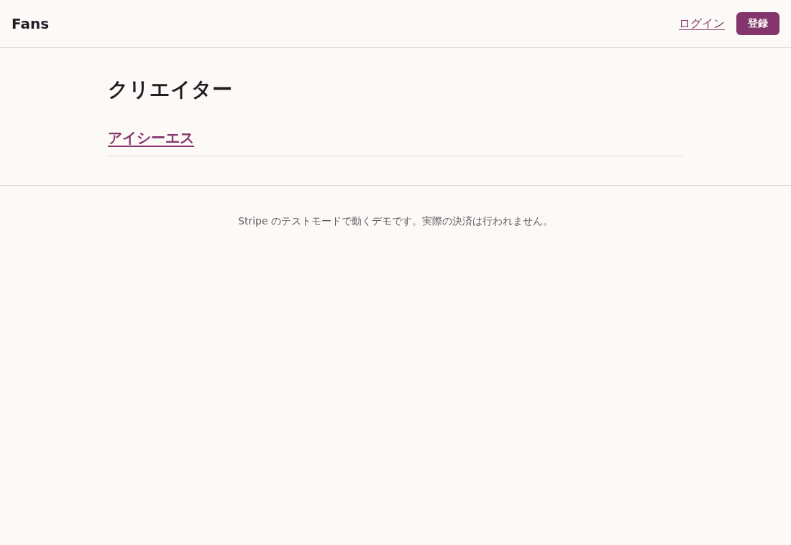
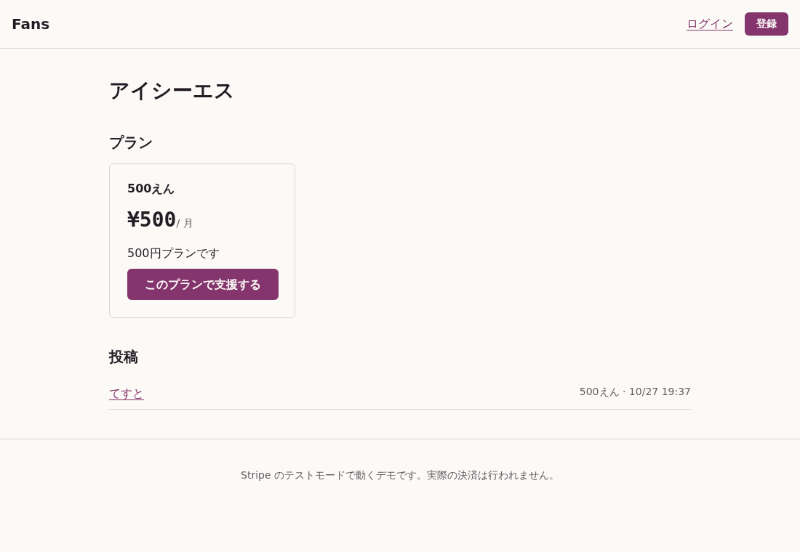
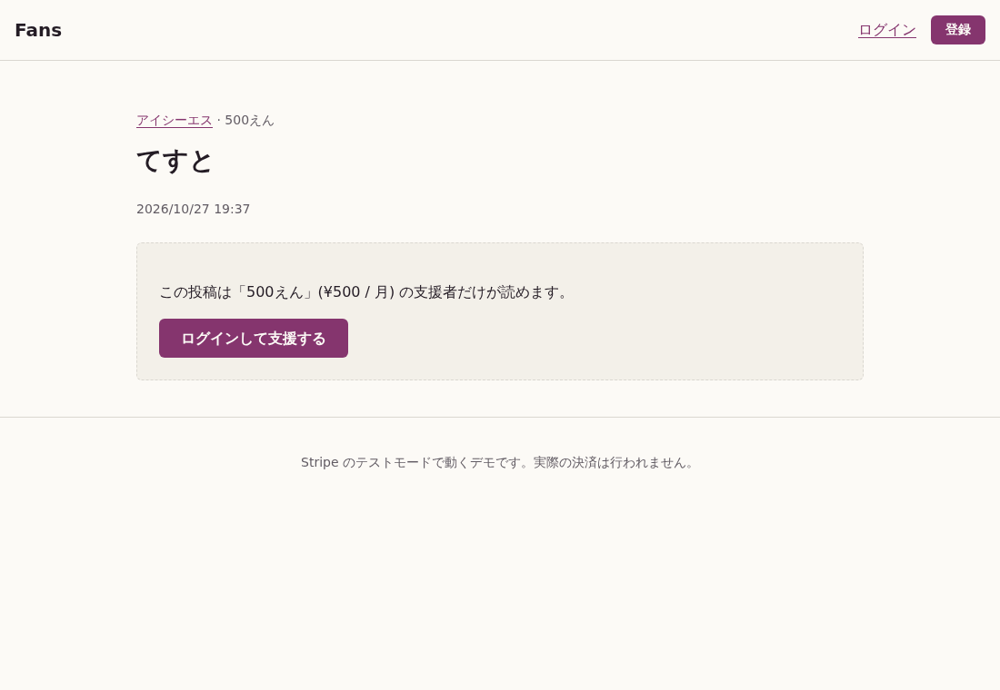
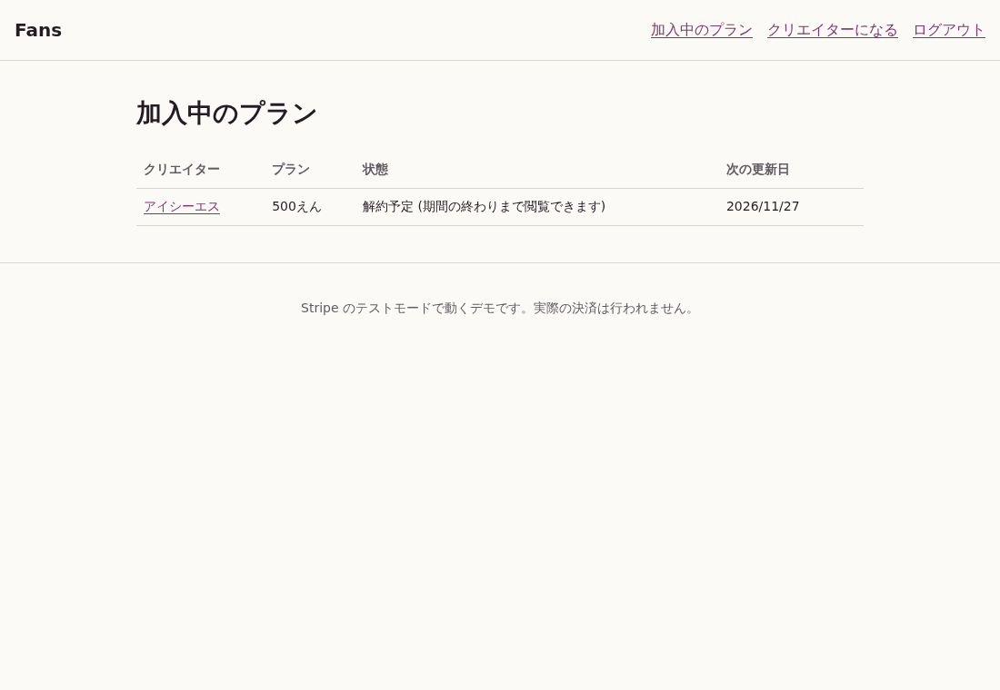
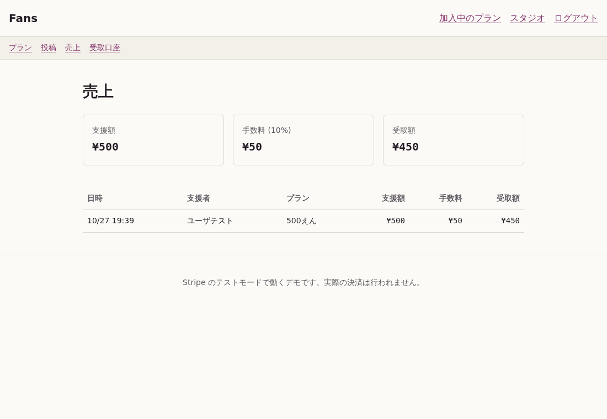
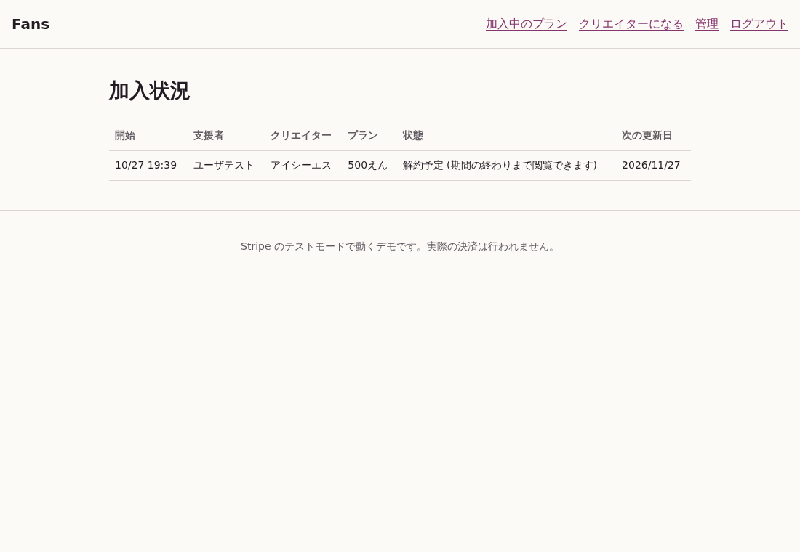

# Fans

クリエイターが月額プランを作り、ファンがプランに加入して限定投稿を読む、小さなファンクラブ型の Web アプリです。決済は Stripe のテストモードで動き、実際の課金は発生しません。

公開先: https://fans.yagamin.net (自宅の Kubernetes で動かしているため、保守のために止まっていることがあります)

## 作った理由

<!-- TODO(作者): 自分の言葉で書き直す -->
Stripe Connect を使った精算の仕組みを、Django で本番運用してきました。同じ題材を Rails の作法で書き直すと、どこが同じでどこが違うのかを確かめられると考えて作りました。

## できること

- 誰でもまずファンとして登録する (Devise)。同じアカウントのまま「クリエイターになる」を選ぶと、クリエイターとしても使える
- クリエイターは Stripe Connect の受取口座を登録し、月額プランと、プランごとの限定投稿 (画像つき) を作る。ほかのクリエイターを応援することもできる
- ファンはプランに加入すると、そのプランの投稿だけを読める。解約すると、期間の終わりで読めなくなる
- 支援額から手数料 10% を引いた額がクリエイターに送金され、その内訳を売上として記録する
- 管理者は加入状況を一覧できる

## 画面

公開している fans.yagamin.net の実際の画面です (Stripe のテストモードのデータ)。

### クリエイター一覧



### クリエイターのページ



### 未加入のときの投稿

プランに加入していない人には本文を出さずに支援の案内を出します。



### 加入中のプラン

解約を受け付けると「解約予定」と表示し、期間の終わりまで閲覧できます。



### 売上

支援額から手数料 10% を引いた受取額を支援ごとに記録します。



### 加入状況 (管理者)



## 設計の判断

### 決済の流れ

```
ファン ── Checkout ──> Stripe ──(webhook)──> POST /webhooks/stripe
                                              │ 署名を検証し StripeEvent に保存して 200
                                              ▼
                                         StripeEventJob (Solid Queue)
                                              │ 最新の Subscription を Stripe から取得
                                              ▼
                                   subscriptions / ledger_entries を更新
```

- webhook はすぐに 200 を返し、処理はジョブに回します。Stripe は応答が遅いと再送するため、受信と処理を分けています。
- 同じイベントは二度処理しません。`stripe_events.stripe_event_id` と `ledger_entries.stripe_invoice_id` に一意制約を付け、`create_or_find_by!` で保存します。一意性は DB の制約だけで守り、モデルの `uniqueness` 検証は付けていません。検証があると、制約に当たる前に検証エラーで止まり、再送を正常に受け流せないためです (テストで見つけました)。
- 処理の結果はイベントの到着順に左右されません。Subscription のイベントを受けたら、ペイロードの値は使わず Stripe から最新の状態を取り直して反映します。古い `updated` が `deleted` の後に届いても、解約が取り消されることはありません。
- 閲覧の可否は状態と期限の両方で判定します。`status` が active でも、`current_period_end` を過ぎていれば読めません。webhook を取りこぼしたときに、読める状態が残り続けないようにするためです。
- 送金には destination charge を使います。Checkout の `subscription_data` に `transfer_data.destination` と `application_fee_percent` を渡し、プラットフォームの手数料を引いた額をクリエイターの口座へ送ります。

### 売上の金額

手数料は `支援額 × 10%` を切り捨てで計算し、受取額は `支援額 − 手数料` とします。合計が支援額に一致することをモデルの検証で確かめています。Stripe 側で実際に差し引かれた手数料 (application fee) との突き合わせはしていません。

### Kubernetes での構成

自宅の RKE2 クラスタで、Argo CD が `k8s/overlays/production` を同期します。

| リソース | 内容 |
|---|---|
| `fans-web` | Puma + Thruster。`/up` を readiness / liveness に使う |
| `fans-worker` | Solid Queue (`bin/jobs`)。webhook のイベントを処理する |
| `fans-migrate` | Argo CD の Sync フックで `db:prepare` を流す Job。web と worker より先に走る |
| `fans-pg` | CloudNativePG の 1 インスタンス。アプリ用と Solid Queue 用の 2 データベース |
| `fans-storage` | Active Storage のアップロード先 (Longhorn の PVC) |

CI (GitHub Actions) はテストが通るとイメージを GHCR に push し、そのダイジェストを `k8s/overlays/production/kustomization.yaml` に書き戻します。Argo CD はその変更を拾って反映します。

Pod は非 root・読み取り専用のルートファイルシステムで動かし、namespace には Pod Security の restricted を適用しています。NetworkPolicy で、外からは ingress-nginx だけが web に届き、DB には自アプリの Pod だけが届くようにしています。

## Django と Rails の違いで気づいた点

<!-- TODO(作者): 実際に書いてみての感想を、自分の言葉で書き直す -->
- 認証: Django は `django.contrib.auth` が標準で入っています。Rails は Devise を足し、ユーザーモデルの生成からルーティングまでを Devise に任せる形になりました。
- 入力の受け付け: Django は Form / Serializer で検証と許可を一度に書きます。Rails は許可をコントローラの `params.expect`、検証をモデルの `validates` に分けて書きます。
- マイグレーション: Django はモデルの定義から差分を自動生成します。Rails はマイグレーションを先に書き、スキーマは `db/schema.rb` に出力されます。
- ジョブ: Django では Celery と Redis を別に用意していました。Rails 8 は Solid Queue が標準で、PostgreSQL だけで動きます。

## 手元で動かす

Docker があれば動きます。Ruby を手元に入れる必要はありません。

```sh
docker compose run --rm app bin/setup --skip-server   # gem の導入と DB の作成
docker compose run --rm app bin/rails db:seed         # デモ用のユーザーと投稿
docker compose up
```

http://localhost:3000 を開き、次のアカウントでログインします (パスワードはすべて `password123`)。

| メールアドレス | 種類 |
|---|---|
| `creator@example.com` | クリエイター |
| `fan@example.com` | ファン |
| `admin@example.com` | 管理者 |

### 決済まで試す場合

Stripe のテストモードのキーが必要です。`.env` に書きます (`.env` は Git の管理から外しています)。

```sh
STRIPE_SECRET_KEY=sk_test_...
STRIPE_WEBHOOK_SECRET=whsec_...   # stripe listen が表示する値
```

webhook は Stripe CLI で転送します。

```sh
stripe listen --forward-to localhost:3000/webhooks/stripe
```

シードのクリエイターには Stripe の口座が無いため、決済を試すときは新しくクリエイターを登録し、「受取口座」から Connect の登録を済ませてください。カード番号は `4242 4242 4242 4242` を使います。

アプリはテストモード以外のキーでは起動しません (`config/initializers/stripe.rb`)。

## テスト

```sh
docker compose run --rm app bundle exec rspec
```

閲覧制限 (`spec/models/post_spec.rb`)、webhook の署名検証と二重処理の防止 (`spec/requests/stripe_webhooks_spec.rb`)、売上の金額 (`spec/models/ledger_entry_spec.rb`)、Checkout に渡す送金先と手数料 (`spec/requests/checkouts_spec.rb`) を確かめています。Stripe の API 呼び出しはすべてテストの中で差し替えています。N+1 クエリは Bullet で検出し、テスト中に見つかると失敗します。

## 作っていないもの

小さく作って先に動かすため、次のものは作っていません。

| 機能 | 理由 |
|---|---|
| パスワードの再設定 | メールの送信経路を用意していないため |
| プランの変更 (アップグレード・日割り) | 加入と解約の流れを先に固めるため |
| 通知、検索、ランキング | 題材の中心ではないため |
| Stripe の手数料実額との突き合わせ | 上の「売上の金額」を参照 |
| Connect の `account.updated` webhook | 受取口座の状態は、登録画面から戻ったときに取り直している |
| 画像の S3 / R2 への保存、複数レプリカ | デモの規模では 1 レプリカで足りるため |
| DB のバックアップ | テストモードのデータしか持たないため |
